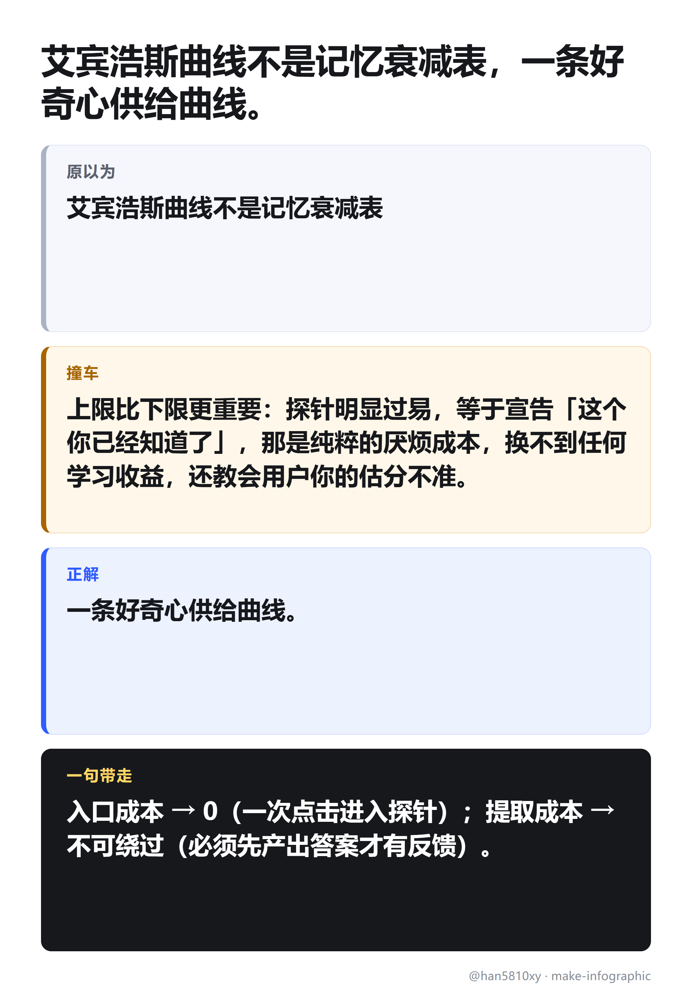
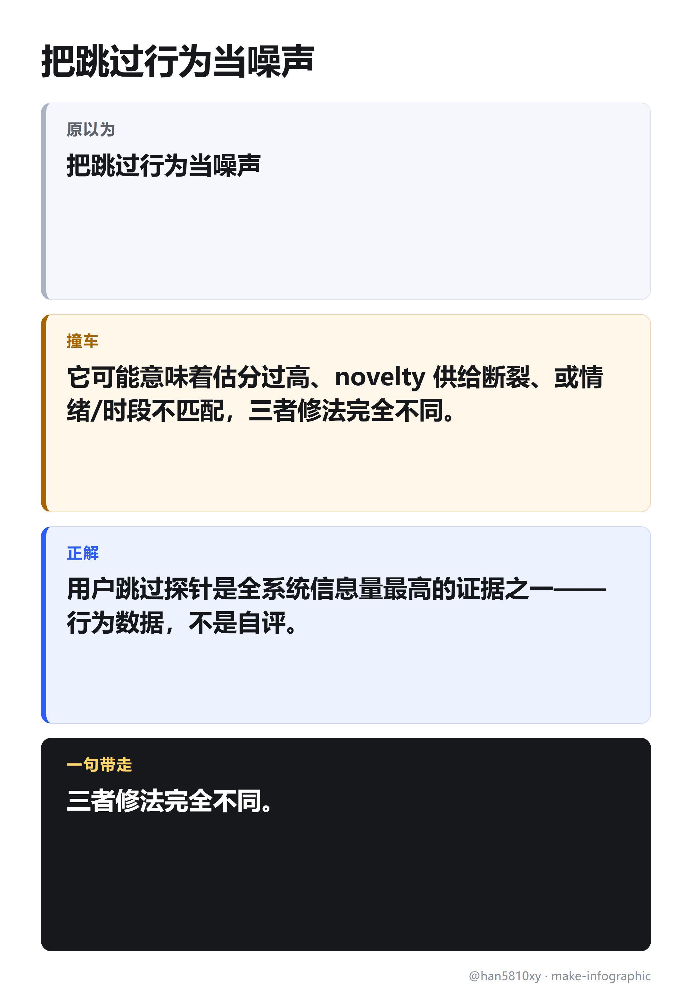
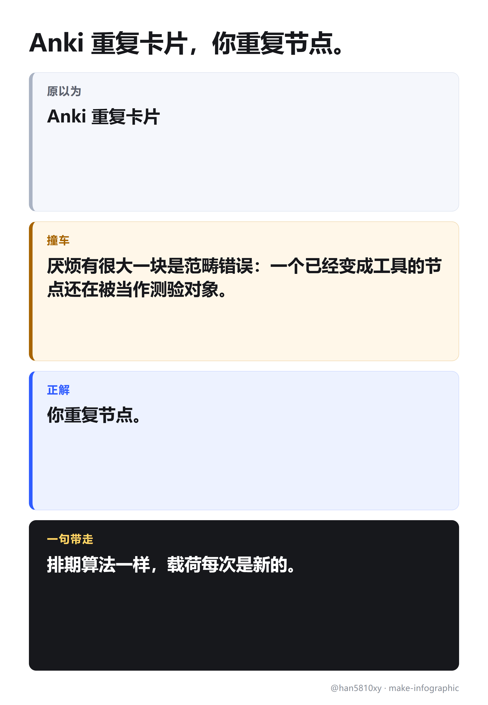

# AI remembers every conversation. You remember one image.


**Before → Collision → Correction → Takeaway.** Not a summary — a record of how your thinking changed.

## Try it without installing

[https://han5810xy-dotcom.github.io/make-infographic/](https://han5810xy-dotcom.github.io/make-infographic/)

Paste a conversation, click 出图, and download the PNG. It runs entirely in your browser, calls no model, and never uploads your text.

## One-line install

Windows PowerShell:

```powershell
curl.exe -L -o install.mjs https://raw.githubusercontent.com/han5810xy-dotcom/make-infographic/main/dist/install.mjs; curl.exe -L -o make-infographic-1.0.0.zip https://github.com/han5810xy-dotcom/make-infographic/releases/download/v1.0.0/make-infographic-1.0.0.zip; node install.mjs
```

macOS / Linux:

```bash
curl -L -o install.mjs https://raw.githubusercontent.com/han5810xy-dotcom/make-infographic/main/dist/install.mjs && curl -L -o make-infographic-1.0.0.zip https://github.com/han5810xy-dotcom/make-infographic/releases/download/v1.0.0/make-infographic-1.0.0.zip && node install.mjs
```

Then select a conversation in Qoder and say: **出图**.

## Three examples

<p align="center">
  <a href="examples/01-curiosity/"></a>
  <a href="examples/02-skip-signal/"></a>
  <a href="examples/03-repeat-node/"></a>
</p>

- [Curiosity and spaced repetition](examples/01-curiosity/): the forgetting curve is also a curiosity supply curve.
- [Skipping is evidence](examples/02-skip-signal/): a skipped probe is behavioral data, not noise.
- [Repeat nodes, not cards](examples/03-repeat-node/): keep the schedule, change the payload.

## Ten-minute validation

**Pending.** The author has not yet run the delayed-recall experiment with 10 real conversations and a three-day gap, so no number is claimed here.

Engineering checks are complete: clean install from the exact ZIP, natural-language trigger in Qoder, real dialogue rendering, resource reads, invalid-input rejection, PNG download, and mobile layout. Engineering success is not proof of learning effectiveness.

## Boundaries

- Visible body text is capped at 300 characters; overflow is trimmed without shrinking type, truncation, or ellipses.
- Missing Before, Collision, or Correction blocks stop rendering instead of inventing a twist.
- Non-verbatim text is marked as a summary in JSON and terminal output only.
- Uses installed Edge or Chrome; never downloads Chromium and needs no API key.
- Without a browser, only HTML can be generated and is explicitly marked untested.

## License

MIT. See [LICENSE](LICENSE).
