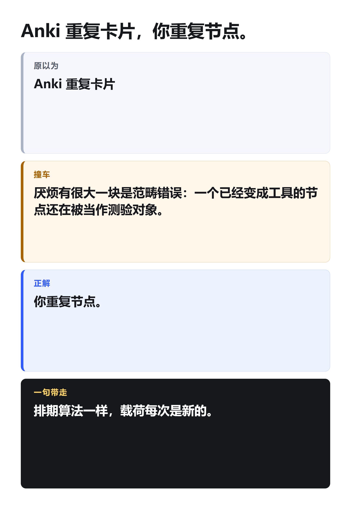

<p align="center">
  
  
  
</p>

# make-infographic

把一段 AI 对话变成一张竖图：**原以为 → 撞车 → 正解 → 一句带走**。不是摘要配图，而是记录你怎样想通。

## 一行安装

Windows PowerShell：

```powershell
curl.exe -L -o install.mjs https://raw.githubusercontent.com/han5810xy-dotcom/make-infographic/main/dist/install.mjs; curl.exe -L -o make-infographic-1.0.0.zip https://github.com/han5810xy-dotcom/make-infographic/releases/download/v1.0.0/make-infographic-1.0.0.zip; node install.mjs
```

macOS / Linux：

```bash
curl -L -o install.mjs https://raw.githubusercontent.com/han5810xy-dotcom/make-infographic/main/dist/install.mjs && curl -L -o make-infographic-1.0.0.zip https://github.com/han5810xy-dotcom/make-infographic/releases/download/v1.0.0/make-infographic-1.0.0.zip && node install.mjs
```

安装脚本会自动找到 Qoder、Claude 或 DSH 的技能目录，检查 Node、pnpm、Edge / Chrome，并装好截图依赖。缺什么会用一句人话告诉你。

## 怎么用

在 Qoder 里选中一段问答、讨论或笔记，对它说：**出图**。

所有内容只留在本机，不需要 API key，也不会上传对话。

## 它会自动处理什么

- 缺「原以为」「撞车」或「正解」：不出图，并说清缺哪一块。
- 正文超过 300 字：自动裁剪，终端打印「未上图」清单；不缩字、不截断、不用省略号。
- 原话不逐字：自动标为「归纳」，只写进 JSON 和终端，不画到图上。
- 传入旧版式：自动换成四块转弯图。
- 1080px 主稿正文 38px，缩到 600px 宽约 21.1px。

## 文件

- `dist/make-infographic-1.0.0.zip`：可安装的 Skill 包。
- `dist/install.mjs`：自动安装脚本。
- `dist/README.md`：写给不会写代码的人看的安装与使用说明。
- `examples/`：三段真实对话和对应转弯图。
- `RELEASE.md`：1.0.0 发布说明。

## License

MIT。详见 [LICENSE](LICENSE)。
