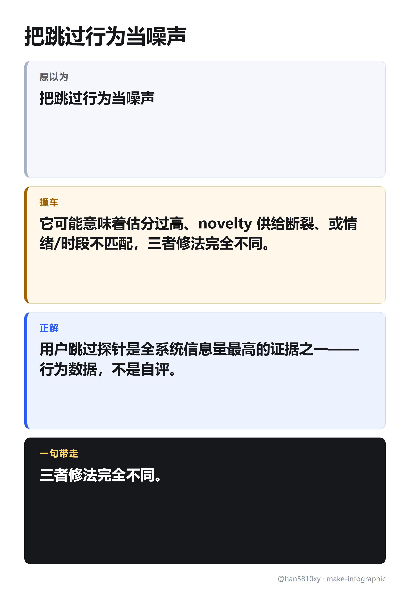

# AI 记得每一次对话，你只记得住一张图。


**原以为 → 撞车 → 正解 → 一句带走。** 不是摘要，是记录你怎么想通的。

## 先零安装体验

[https://han5810xy-dotcom.github.io/make-infographic/](https://han5810xy-dotcom.github.io/make-infographic/)

粘贴一段对话，点「出图」，直接渲染并下载 PNG。纯前端，不调模型，文本不离开浏览器。

## 一行安装

Windows PowerShell：

```powershell
curl.exe -L -o install.mjs https://raw.githubusercontent.com/han5810xy-dotcom/make-infographic/main/dist/install.mjs; curl.exe -L -o make-infographic-1.0.0.zip https://github.com/han5810xy-dotcom/make-infographic/releases/download/v1.0.0/make-infographic-1.0.0.zip; node install.mjs
```

macOS / Linux：

```bash
curl -L -o install.mjs https://raw.githubusercontent.com/han5810xy-dotcom/make-infographic/main/dist/install.mjs && curl -L -o make-infographic-1.0.0.zip https://github.com/han5810xy-dotcom/make-infographic/releases/download/v1.0.0/make-infographic-1.0.0.zip && node install.mjs
```

装好后，在 Qoder 里选中一段对话，说：**出图**。

## 三个示例

<p align="center">
  <a href="examples/01-curiosity/"></a>
  <a href="examples/02-skip-signal/"></a>
  <a href="examples/03-repeat-node/"></a>
</p>

- [好奇心与间隔重复](examples/01-curiosity/)：艾宾浩斯曲线不是记忆衰减表，而是一条好奇心供给曲线。
- [跳过行为是证据](examples/02-skip-signal/)：用户跳过探针不是噪声，是系统信息量最高的行为数据之一。
- [重复节点，不重复卡片](examples/03-repeat-node/)：Anki 重复卡片，你重复节点；排期算法一样，载荷每次是新的。

## 十分钟验证

**待验证。** 作者尚未完成“10 段真实对话 → 三天后只看图复述”的延迟实验，因此不填虚构数字。

当前已完成的是工程验收：准确 ZIP 全新安装、Qoder 自然语言触发、真实对话出图、引用资源读取、异常输入拒绝、PNG 下载与移动端布局。工程通过不等于学习效果已被证明。

## 边界

- 单张可见正文不超过 300 字；超限自动裁剪，不缩字号、不截断、不用省略号。
- 缺少「原以为」「撞车」或「正解」时拒绝出图，不编造反转。
- 非逐字内容标为「归纳」，只进入 JSON 与终端，不画到图上。
- 使用本机 Edge 或 Chrome；不会自动下载 Chromium，不需要 API Key。
- 浏览器不可用时只能生成 HTML，并明确标注「未实测」。

## License

MIT。详见 [LICENSE](LICENSE)。
